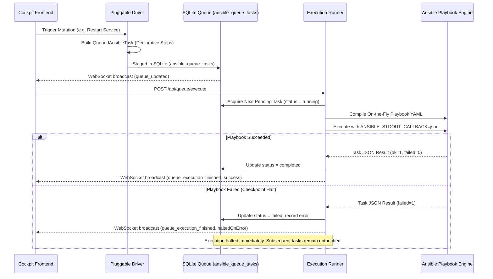
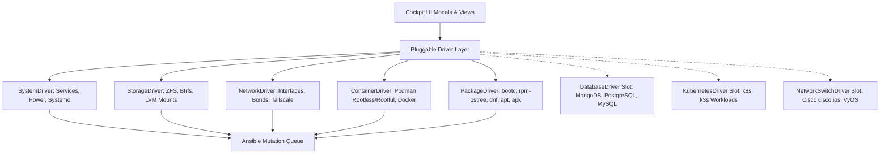

# Air Traffic Control (ATC) Architecture & System Design

Welcome to the architectural specification for **Air Traffic Control** (`air-traffic-control`), the multi-cockpit homelab and datacenter orchestrator.

---

## 1. Architectural Philosophy: Universal SSH Transport vs Agent Model

A primary design requirement of Air Traffic Control is providing single-pane-of-glass orchestration across 47+ heterogeneous physical and virtual nodes (Fedora CoreOS / Silverblue, Debian, Ubuntu, Alpine Linux, Proxmox VE, TrueNAS SCALE, VyOS, OpenWrt, and Windows).

### Decision: Agentless Universal SSH
Rather than forcing custom agent installations or requiring continuous daemon maintenance on remote nodes, Air Traffic Control relies on **Universal SSH Transport**:
- **Zero-Footprint Deployment:** No agent binaries, daemons, background listeners, or custom services are installed on target machines. A machine with OpenSSH server and standard user credentials is immediately manageable.
- **SSH Agent Forwarding:** Authentication leverages `SSH_AUTH_SOCK` (or user session sockets like `/run/user/<uid>/ssh-agent.socket`). No private keys are stored on the server or transmitted over unencrypted channels.
- **Multi-Route Resilience:** Node connections dynamically failover across:
  1. Tailscale WireGuard mesh (`100.x.y.z` / `*.ts.net`)
  2. Local Area Network IPv4/IPv6 (`192.168.x.y`, `10.x.y.z`)
  3. Direct loopback (`127.0.0.1` / local host execution)
- **Non-Interactive Batch Mode:** All SSH invocations specify:
  `-F /dev/null -o StrictHostKeyChecking=accept-new -o BatchMode=yes -o ConnectTimeout=4`
  preventing interactive password prompts or hung pseudo-terminals during automated orchestration sweeps.

---

## 2. Modular Capability Autodetection Matrix

Remote nodes run diverse distributions, init systems, privilege policies, and storage engines. Air Traffic Control inspects host capabilities dynamically rather than assuming a rigid stack.

```mermaid
flowchart TD
    Node[Target Node Probed via SSH] --> Escalation[1. Privilege Escalation Engine]
    Node --> Runtimes[2. Container Runtimes]
    Node --> Storage[3. Storage Subsystems]
    Node --> SystemMgr[4. Service & Log Managers]
    Node --> PkgMgr[5. Package & OS Upgrades]

    Escalation --> Run0[run0: systemd 256+ polkit session]
    Escalation --> Sudo[sudo -n: passwordless sudo]
    Escalation --> Doas[doas -n: OpenBSD/Alpine]
    Escalation --> None[none: root user or unprivileged]

    Runtimes --> PodmanRootless[Rootless Podman per /run/user/UID]
    Runtimes --> PodmanRoot[Rootful Podman]
    Runtimes --> DockerCli[Docker Daemon / Socket]

    Storage --> ZFS[OpenZFS: zpool & zfs datasets]
    Storage --> Btrfs[Btrfs: multi-device & subvolumes]
    Storage --> LVM[LVM / ext4 / XFS / findmnt]

    SystemMgr --> CockpitOpt[cockpit-bridge: Optional framing]
    SystemMgr --> Journalctl[systemctl & journalctl CLI fallback]
    SystemMgr --> Dmesg[dmesg & syslog fallback]

    PkgMgr --> Immutable[bootc & rpm-ostree containerized]
    PkgMgr --> Traditional[dnf, apt, apk]
```

### 2.1 Privilege Escalation Hierarchy
Privilege detection evaluates capabilities strictly in order of modern security architecture:
1. **`run0` (Preferred):**
   - Introduced in systemd 256+.
   - Elevates via `systemd-run` and Polkit without creating SUID binaries or stripping environment variables.
   - Preserves logind session context and DBus session bus access.
   - Invocation: `run0 --background=no <command>`.
2. **`sudo -n` (Fallback):**
   - Standard passwordless sudo invocation for conventional distributions.
   - Invocation: `sudo -n <command>`.
3. **`doas -n` (Lightweight Fallback):**
   - Non-interactive doas invocation commonly used in Alpine Linux, OpenBSD, and minimalism-oriented setups.
   - Invocation: `doas -n <command>`.
4. **`none` (Direct):**
   - Applied when authenticated directly as `root` (no wrapper prefix required), or for strictly unprivileged users when no elevation mechanism exists.

### 2.2 Optional Cockpit Bridge (Zero Hard Dependency)
- `cockpit-bridge` is used strictly as an **optional framing protocol**.
- If `cockpit-bridge` is installed on the host, Air Traffic Control can frame DBus payloads.
- **Invariant:** If `cockpit-bridge` is absent, the backend **must not fail or crash**. All operations (reading journal logs, controlling systemd units, querying hardware disks, managing storage) gracefully execute directly via native CLI utilities (`journalctl`, `systemctl`, `smartctl`, `zpool`).

### 2.3 Container Runtime Probing
- Rootless containers are isolated per user. Air Traffic Control discovers active container users by probing `/run/user/<uid>/libpod`, `/run/user/<uid>/podman`, and user process lists.
- For each discovered unprivileged user, container and pod lists are queried via:
  `run0 --background=no --user <user> podman ps --all --format json` or
  `sudo -n -u <user> XDG_RUNTIME_DIR=/run/user/<uid> podman ps --all --format json`
- Docker fallback probes `docker ps` when Podman is not active.
- Infrastructure pause containers (`podman-pause`) are automatically filtered from views to prevent UI clutter.

### 2.4 Storage Engine Autodetection
1. **OpenZFS:** Probes `zpool list -H` and `zpool status`. Extracts pool health, scan scrub progress, fragmentation, and vdev topology.
2. **Btrfs:** Probes `btrfs filesystem show`. Maps multi-device UUIDs and active subvolume mounts.
3. **Standard Mounts & LVM:** Probes `findmnt -J` or fallback tabular text. Extracts ext4, xfs, nfs, and cifs mounts.

### 2.5 Package & Immutable OS Management
The system inspects package managers by prioritizing modern immutable container-based systems before traditional package managers:
1. `bootc`: Image-based transactional updates (`bootc status`, `bootc upgrade`).
2. `rpm-ostree`: Hybrid immutable deployments (`rpm-ostree upgrade --check`, `rpm-ostree upgrade`).
3. `dnf`: Fedora / RHEL / Rocky (`dnf check-update -q`).
4. `apt`: Debian / Ubuntu / Proxmox (`apt-get -s upgrade`).
5. `apk`: Alpine Linux (`apk version -v -l '<'`).

---

## 3. High-Performance Host Daemon (`backend-go`)

The Go daemon (`air-traffic-control-daemon`) acts as a high-throughput, low-latency companion for heavy host operations:
- **`pkg/ssh`:** Connection pooling and SSH agent authentication with socket autodetection.
- **`pkg/cockpit`:** Bridge session management, privilege elevation wrapping (`run0` -> `sudo` -> `doas`), and journal JSON parsing.
- **`pkg/podman`:** Rootless user discovery and multi-user container inspection.
- **`pkg/glances`:** Fast REST telemetry consumption with structured JSON normalization.
- **`pkg/restic`:** Snapshot parsing and backup integrity operations.

---

## 4. Persistent SQLite Architecture & Cache TTLs

To prevent SSH command flooding on the homelab network, telemetry and probe results are cached in `data/hosts-cache.sqlite` with WAL mode:
- **`PRAGMA journal_mode = WAL;`** and **`PRAGMA synchronous = NORMAL;`**
- **Cache TTL Tiers:**
  - Fast telemetry / CPU / Watts: 15 seconds
  - Container and Pod state: 20 seconds
  - Network interfaces and routing: 30 seconds
  - Firewall tables: 45 seconds
  - Disks, ZFS pools, Shares, VMs: 60 seconds
- **Mutation Invalidation:** Every mutating endpoint (`PUT /api/nodes/:id`, interface edits, container lifecycle triggers) immediately invalidates associated cache keys.

---

## 5. Strict Zero-Mock Policy

As codified in `AGENTS.md`:
- Every button, action, and metric must represent real host execution.
- No `setTimeout` or local React state mutations simulating host responses.
- If a node is unreachable or elevation fails, the error must be reported accurately without synthetic masking.

---

## 6. On-the-Fly Playbook Queue & One-by-One Checkpoint Runner

All system mutations (network, firewall, container, storage, package, and service operations) are staged and executed through declarative Ansible tasks rather than ephemeral CLI strings.

### 6.1 Checkpoint Halting Invariant
- Tasks run strictly one-by-one.
- If a task or step fails, the queue **halts immediately**.
- Subsequent tasks remain safely staged in SQLite without execution. This prevents compounding misconfigurations (e.g., attempting to restart dependent services after a configuration file syntax check failed).

---

## 7. Pluggable Driver Architecture & Extensibility

Cockpit abstracts host management through pluggable, strongly-typed driver interfaces. Each driver compiles high-level UI intents into structured `AnsibleTaskStep` definitions:

### 7.1 Implemented Drivers
- **`SystemDriver`:** Manages systemd unit lifecycles (`ansible.builtin.systemd_service`), privilege elevation, and node reboot/power commands.
- **`StorageDriver`:** Manages OpenZFS datasets and snapshots, Btrfs subvolumes, and filesystem mount configurations (`ansible.posix.mount`).
- **`NetworkDriver`:** Manages network interfaces, static IP/DHCP bindings, and firewall tables (`ansible.posix.firewalld`).
- **`ContainerDriver`:** Manages rootless and rootful Podman containers, Quadlets, pods, and Docker fallback.
- **`PackageDriver`:** Orchestrates atomic immutable OS updates (`bootc`, `rpm-ostree`) and traditional package transactions (`ansible.builtin.package`).

### 7.2 Future Expansion Driver Slots
The architecture includes dedicated modular slots for homelab expansions:
- **`DatabaseDriver`:** Extends task generation to database maintenance operations (MongoDB replica sets, PostgreSQL backups/WAL archiving, MySQL migrations).
- **`KubernetesDriver`:** Extends cluster operations to Kubernetes/k3s manifests, cordon/drain nodes, and deployment rollouts.
- **`NetworkSwitchDriver`:** Extends infrastructure orchestration to managed top-of-rack switches via collections like Cisco `cisco.ios.*` or Arista EOS.

---

## 8. Ansible Engine Standards & Secret Protection

### 8.1 Structured JSON Callback
To provide live accordion drill-down and structured step status in the frontend Console drawer:
- All playbook executions MUST export `ANSIBLE_STDOUT_CALLBACK=json` (configured via `ansible.cfg` `[defaults] stdout_callback = json`).
- Output is parsed into per-task status objects (`ok`, `changed`, `failed`, `skipped`) and streamed to the UI.

### 8.2 Native Module Prioritization
1. **Core Built-ins First:** All drivers must prioritize native modules (`ansible.builtin.*`, `ansible.posix.*`).
2. **Galaxy Collection Guard:** External collections (e.g. `community.general.*`, `cisco.ios.*`) are guarded. If a collection is missing from the environment, the backend alerts the user and prompts for installation via `POST /api/ansible/collections/install`.
3. **Shell/Command Last Resort:** Raw `ansible.builtin.shell` or `ansible.builtin.command` is strictly restricted to cases where no declarative module exists, and must include documented rationale.

### 8.3 Secret Protection Invariant
- Sensitive attributes (passwords, auth tokens, private keys) are never exposed in plaintext in task summaries, YAML payloads, or execution logs.
- Secrets are masked with `•••••••• (vault: <var_name>)` and injected via Ansible Vault or secure extra variables.

---

## 9. Conservative Multi-Tier Telemetry Engine

To prevent polling storms and CPU spikes across 47+ homelab nodes, telemetry collection operates under a conservative polling architecture:

- **Cadence:** Polling runs at 30–60 second intervals (default 45s).
- **4-Tier Degradation Hierarchy:**
  1. **Tier 1 (Direct Glances HTTP REST):** Fast REST API query (`http://<host>:61208/api/4/...`) with 2.5s timeout.
  2. **Tier 2 (SSH Localhost Curl):** Fallback querying Glances via SSH loopback when the HTTP port is bound to localhost.
  3. **Tier 3 (Glances CLI):** Fallback executing `glances --stdout-json cpu,mem,load,sensors` over SSH when the daemon is not running.
  4. **Tier 4 (proc/sysfs Direct Extraction):** Fallback reading `/proc/stat`, `/proc/meminfo`, and `/sys/class/thermal` directly over SSH.
- **Strict Zero-Mock Invariant:** If all 4 tiers fail, the node displays an unmonitored / offline status. No synthetic numbers or fluctuating mock telemetry is ever generated.
