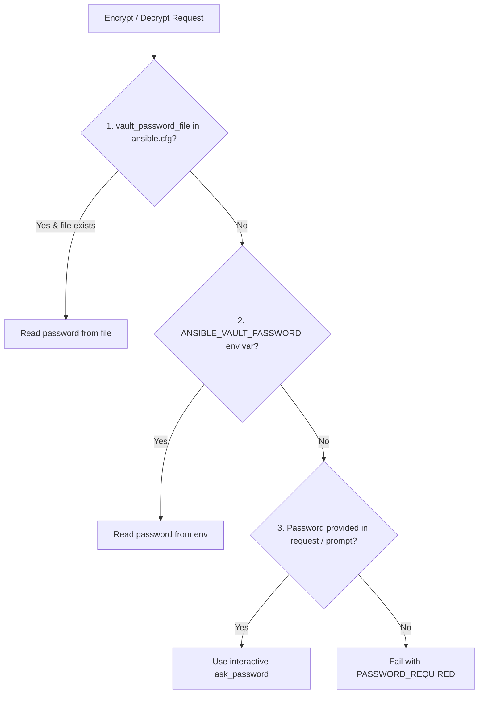

# Technical Design Specification: Multi-Path Node Onboarding, Tiered Ansible Vault, & Hierarchical Inventory

**Document Path:** `docs/superpowers/specs/2026-10-19-inventory-onboarding-hierarchy-design.md`  
**Date:** 2026-10-19  
**Status:** DRAFT (Under Review)  
**Author:** AI Pair Programmer & System Architect  

---

## 1. Intent & Context (The "Why")

In Air Traffic Control (`air-traffic-control`), managing 47+ heterogeneous physical, virtual, and containerized nodes across Tailscale mesh networks and local networks requires flexible onboarding and an intuitive inventory structure.

Previously, adding a node was limited to a single flat form that blended Tailscale peers with manual SSH options, lacked WinRM support for Windows nodes, stored credentials in plaintext, and had no mechanism to follow dynamic groups of nodes sharing a common tag.

This project introduces three core capabilities:
1. **Four Dedicated Onboarding Pathways in the Add Node Modal:**
   - **Tailscale Manual Selection:** Direct selection from unmanaged mesh peers with auto-populated metadata.
   - **Manual SSH Details:** Custom host/port/user with passwords and private keys encrypted into Ansible Vault.
   - **WinRM Connection:** Dedicated Windows Remote Management (HTTP 5985 / HTTPS 5986) with Vault-secured credentials.
   - **Follow Tailscale Tag (Dynamic Inventory Chunk):** Follow an arbitrary Tailscale tag (e.g. `tag:worker`), with shared credentials (or defaulting to keyless Tailscale SSH if left blank), dynamically discovering and maintaining member hosts.
   - *SSH-Agent forwarding is kept explicitly for local testing only.*
2. **Tiered Ansible Vault Credential Engine:**
   - Encryption and decryption resolve passwords in strict priority: `vault_password_file` (from `ansible.cfg` / path) > `ANSIBLE_VAULT_PASSWORD` / `ANSIBLE_VAULT_PASSWORD_FILE` environment variables > interactive `ask_password` prompt.
   - Stored credentials conform strictly to standard Ansible Vault format (`!vault | $ANSIBLE_VAULT;1.1;AES256`).
3. **Hierarchical Inventory Sidebar Tree:**
   - Visualized per the operator's sketch:
     ```
     Inventory
       <ts-shortname>
         <tag1>
           <host 1>
           <host 2>
         <tag2>
           <host 3>
           <host 4>
       (non ts-host)
       <non-ts-host 2>
       <Folder/>
         <non ts-host 3>
     ```
   - Tailscale tree partitioned into collapsible tag chunks.
   - Non-Tailscale tree partitioned into standalone hosts and user-created custom folders.
4. **Automated `uv` Bootstrapper & Persistent Container Virtualenv:**
   - If `uv` is not present on `PATH`, the application automatically pulls/downloads the `uv` standalone binary into a persistent storage location (`data/bin/uv`).
   - Uses `uv venv` to create a dedicated Python virtualenv saved in a persistent volume directory (`data/ansible-venv`), ensuring persistence across container redeployments.
   - Automatically installs `ansible-core`, `pywinrm` (for Windows WinRM nodes), `requests`, `jmespath`, `cryptography`, and required plugin dependencies into this venv.
   - All Ansible queue executions and Vault operations transparently execute using the binaries in this managed venv.

---

## 2. Architecture & Data Models

### 2.1 Core Types (`src/types/index.ts`)

```typescript
export interface TagInventoryChunk {
  id: string; // e.g. "chunk-tag:worker"
  tag: string; // e.g. "tag:worker"
  sshUser?: string; // shared SSH/WinRM user, defaults to 'core' or 'Administrator'
  vaultSecretId?: string; // encrypted password or ssh key vault entry
  authMethod: 'tailscale-ssh' | 'vault-password' | 'vault-sshkey' | 'ssh-agent';
  createdAt: number;
}

export interface CustomFolder {
  id: string; // e.g. "folder-cold-storage"
  name: string; // e.g. "Cold Storage"
  createdAt: number;
}

// Extensions to NodeItem:
export interface NodeItem {
  // Existing fields...
  connectionProtocol?: 'ssh' | 'winrm' | 'tailscale_ssh';
  vaultSecretId?: string;
  folder?: string; // custom folder ID if non-tailscale
  isDynamicTagMember?: boolean;
  followedTag?: string;
}
```

### 2.2 Tiered Vault Resolution



---

## 3. API Contract (`server.ts`)

- `GET /api/vault/status`: Returns `{ success: true, hasPasswordSource: boolean, source: 'file' | 'env' | 'ask_password' }`.
- `POST /api/vault/encrypt`: Accepts `{ plaintext: string, varName?: string, password?: string }`, returns `{ success: true, vaultBlock: string }`.
- `POST /api/vault/decrypt`: Accepts `{ vaultBlock: string, password?: string }`, returns `{ success: true, plaintext: string }`.
- `GET /api/inventory/chunks`: Returns `{ success: true, chunks: TagInventoryChunk[] }`.
- `POST /api/inventory/chunks`: Accepts `TagInventoryChunk`, triggers immediate sync of matching peers, returns `{ success: true, chunk }`.
- `DELETE /api/inventory/chunks/:id`: Removes chunk and unlinks dynamic tag members.
- `GET /api/inventory/folders`: Returns `{ success: true, folders: CustomFolder[] }`.
- `POST /api/inventory/folders`: Creates/updates custom folder.
- `DELETE /api/inventory/folders/:id`: Deletes custom folder and unassigns member nodes.

---

## 4. Invariants & Zero-Mock Enforcement

1. **Vault Security Invariant:** Cleartext passwords and private keys are never persisted in SQLite or returned over public REST APIs. They must be stored in encrypted `$ANSIBLE_VAULT;1.1;AES256` blocks.
2. **Local Testing Guard:** `ssh-agent forwarding` is clearly demarcated in the UI as `(Local testing only)`. Production options default to Tailscale SSH or Vault-secured credentials.
3. **Zero-Mock Policy:** Probing hosts, reading Tailscale peers, and executing vault encryptions run against the live CLI tools (`tailscale status`, `ansible-vault`) or fail with informative error responses.
